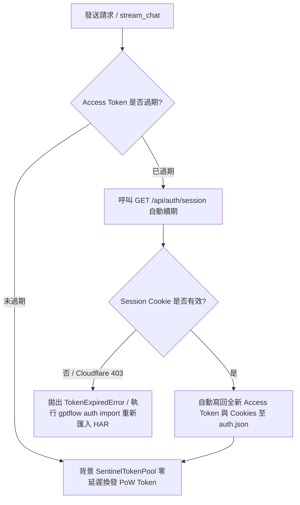

# GPTFlow

基於 Clean Architecture 與 DDD 設計的非同步 ChatGPT Web 逆向工程客戶端與 CLI 工具。

---

## 核心能力清單

- **TLS / JA3 指紋模擬**：內建 `curl_cffi` 模擬 Chrome 131 握手特徵，繞過 Cloudflare WAF 攔截。
- **Sentinel PoW 演算法**：字符級復刻 OpenAI 官方混淆 32 位元 FNV-1a / Murmur 雜湊演算法（`sentinel_hash`），背景 Token 池自動預算。
- **思考鏈 (Thinking / CoT) 原生支援**：帶入 `system_hints: ["reason"]`，終端即時分離並渲染 `思考思維鏈` 區塊。
- **增量修補流解析**：解析 `delta_encoding v1` JSON-patch SSE 事件串流。
- **多輪對話 DAG 管理**：維護本地訊息節點樹與 `parent_message_id` 指標。
- **Token 自動續期機制**：自動透過 NextAuth Session 端點滾動刷新 JWT 與 Cookie，免頻繁重新登入。

---

## 快速開始

### 1. 安裝環境
本專案基於 `uv` 管理環境與依賴：
```bash
# 同步安裝依賴
uv sync
```

### 2. 匯入身分認證 (HAR 匯入)
在瀏覽器開啟 `https://chatgpt.com`，按 F12 開啟「開發者工具」->「網路 (Network)」，任發送一則訊息或重新整理頁面，對請求按右鍵「另存為包含內容的 HAR」，執行：
```bash
# 匯入 HAR 封包 (自動擷取 Authorization Bearer JWT、oai-did 及全部 24 個必要 Cookies)
uv run gptflow auth import "路徑/封包紀錄.json"

# 檢視當前認證狀態
uv run gptflow auth status
```

---

## 💻 CLI 指令完整說明與參數清單

### 1. 串流問答與多輪對話 (`gptflow chat`)

發送提示詞並以串流格式即時輸出回答。可作為單次獨立問答，亦可帶入既有會話 ID 延續多輪對話。

**語法**：
```bash
gptflow chat [OPTIONS] PROMPT
```

**位置參數 (Arguments)**：

| 參數名稱 | 類型 | 必填 | 說明 |
| :--- | :--- | :---: | :--- |
| `PROMPT` | 字串 (`str`) | **是** | 傳送給 ChatGPT 的提示詞或提問內容。若包含空格或特殊符號請使用引號包覆。 |

**選項旗標 (Options)**：

| 長選項 | 短選項 | 類型 | 預設值 | 說明 |
| :--- | :---: | :---: | :---: | :--- |
| `--model` | `-m` | 字串 (`str`) | `auto` | 指定後端模型型號（例如 `auto`, `o1`, `o3-mini`, `gpt-4o`）。 |
| `--thinking` | `-t` | 布林開關 (`bool`) | `False` | 開啟推理思考模式（Thinking / CoT），終端將即時展開思維鏈面板。 |
| `--session` | `-s` | 字串 (`str`) | `None` | 指定接續既有的對話會話 ID（UUID）。傳入後將自動繼承上下文延續對話。 |
| `--debug` | `-d` | 布林開關 (`bool`) | `False` | 開啟詳細 Debug 日誌（顯示底層 HTTP 握手、Sentinel PoW 求解進度等）。 |
| `--help` | | | | 顯示此指令的完整參數說明並退出。 |

**使用範例**：

```bash
# 範例 A：基本單次問答（回答完畢後終端末尾會印出該次對話的「會話 ID」）
uv run gptflow chat "請簡要說明什麼是量子糾纏？"

# 範例 B：開啟思考思維鏈模式 (-t)
uv run gptflow chat "請分析 13*14 的心算方式" -t

# 範例 C：接續既有會話 (-s)，延續上下文多輪提問
uv run gptflow chat "那 17*18 呢？" -s 6ab83da3-4ce8-83e8-860e-1ebac5cb68dc

# 範例 D：指定模型並開啟詳細除錯日誌 (-m, -d)
uv run gptflow chat "寫一個快速排序演算法" -m o3-mini -d
```

---

### 2. 身分認證管理 (`gptflow auth`)

管理本地存儲的身分憑證、查看登入態、刷新 Token 與匯入 HAR 封包。

#### 2.1 匯入憑證 (`gptflow auth import`)
從瀏覽器匯出的 HAR 封包檔案或 JSON 憑證中擷取 Bearer Token、裝置 ID 與所有 Cookies。

**語法**：
```bash
gptflow auth import [OPTIONS] FILE_PATH
```

**位置參數 (Arguments)**：

| 參數名稱 | 類型 | 必填 | 說明 |
| :--- | :--- | :---: | :--- |
| `FILE_PATH` | 路徑 (`Path`) | **是** | 瀏覽器 DevTools 匯出的 HAR 檔案（`.har`, `.json`）或憑證 JSON 路徑。 |

**使用範例**：
```bash
uv run gptflow auth import "Packet/第二個 session 封包紀錄.json"
```

#### 2.2 檢視憑證狀態 (`gptflow auth status`)
檢視當前已儲存的使用者 Email、使用者 ID、訂閱方案、裝置 ID、有效 Cookie 數量以及 Token 是否已過期。

**語法**：
```bash
gptflow auth status [OPTIONS]
```

**使用範例**：
```bash
uv run gptflow auth status
```

#### 2.3 刷新 Access Token (`gptflow auth refresh`)
使用本地已儲存的 Session Cookie 主動向 ChatGPT 伺服器換發全新的 Access Token 與延長 Cookies 效期。

**語法**：
```bash
gptflow auth refresh [OPTIONS]
```

**選項旗標 (Options)**：

| 長選項 | 類型 | 預設值 | 說明 |
| :--- | :---: | :---: | :--- |
| `--debug` | 布林開關 (`bool`) | `False` | 開啟刷新流程的詳細除錯日誌。 |
| `--help` | | | 顯示此指令的說明並退出。 |

**使用範例**：
```bash
# 正常刷新
uv run gptflow auth refresh

# 開啟除錯日誌刷新
uv run gptflow auth refresh --debug
```

---

### 3. 對話會話管理 (`gptflow session`)

檢視與管理存儲於本地 `sessions/` 目錄中的 DAG 對話歷史記錄。

#### 3.1 列出所有會話 (`gptflow session list`)
列出本地存儲的所有會話 ID 以及該會話內包含的訊息總節點數。

**語法**：
```bash
gptflow session list [OPTIONS]
```

**使用範例**：
```bash
uv run gptflow session list
```

#### 3.2 檢視指定會話詳細內容 (`gptflow session show`)
完整還原指定會話內的所有訊息歷史，包含使用者提問、模型思考過程（若有）與 ChatGPT 的回覆內容。

**語法**：
```bash
gptflow session show [OPTIONS] SESSION_ID
```

**位置參數 (Arguments)**：

| 參數名稱 | 類型 | 必填 | 說明 |
| :--- | :--- | :---: | :--- |
| `SESSION_ID` | 字串 (`str`) | **是** | 要查詢的會話 ID（可透過 `session list` 獲取）。 |

**使用範例**：
```bash
uv run gptflow session show 6ab83da3-4ce8-83e8-860e-1ebac5cb68dc
```

---

## Token 與 Cookie 壽命及過期處置機制

### 1. 各種 Token 與 Cookie 的有效期限

| 憑證類型 | 來源與機制 | 預估效期 | 過期表現 |
| :--- | :--- | :--- | :--- |
| **Sentinel Token**<br>(`chat_requirements_token`) | PoW 計算與 `/sentinel/finalize` 換發 | **約 3 分鐘** | 請求拒絕 (403 Sentinel Failed) |
| **Access Token**<br>(`Authorization: Bearer <JWT>`) | `https://auth.openai.com` 簽發的 JWT | **約 10 ~ 14 天**<br>(見 payload `exp`) | 請求報 401 Unauthorized |
| **Session Cookie**<br>(`__Secure-next-auth.session-token`) | NextAuth 登入憑證 (分卷存於 `.0` 與 `.1`) | **約 30 ~ 90 天**<br>(滾動式延長) | 無法刷新 Access Token |
| **Cloudflare Cookies**<br>(`cf_clearance`, `__cf_bm`) | Cloudflare 邊緣節點防護與機器人驗證 | **30 分鐘 ~ 數天**<br>(受 IP 變更影響) | 請求報 403 CloudflareBlockedError |
| **裝置識別碼**<br>(`oai-did`) | OpenAI 裝置綁定 UUID | **1 年** | 無實質影響 |

---

### 2. 過期時的處置流程



1. **Access Token 過期（無感自動處理）**：
   - 當程式檢測到 Access Token 到期時，**`ChatService` 會自動攔截並帶上現有 Cookie 呼叫 `GET /api/auth/session`**。
   - 伺服器會返回新的 `accessToken` 與更新後的滾動 Cookies，系統自動持久化回 `user_cookies/auth.json`，對話流程完全無中斷。
   - 亦可隨時手動執行 `uv run gptflow auth refresh` 進行續期。

2. **Sentinel Token 過期（無感自動處理）**：
   - 由 `SentinelTokenPool` 在背景常駐預運算，需要送出對話時直接取出已求解之新鮮 Token（效期內），耗盡時自動非同步補充。

3. **Cookie 過期 / 網路 IP 變更（需重新匯入）**：
   - **成因**：當外網 IP 變更（如切換 WiFi / VPN）導致 Cloudflare `cf_clearance` 失效，或超過 30~90 天 Session 自然失效、或手動在網頁點擊了「登出」。
   - **處置方式**：
     - 打開瀏覽器訪問 `https://chatgpt.com` 重新登入或按 F5。
     - DevTools 匯出最新 HAR 檔案。
     - 終端執行：`uv run gptflow auth import <new.har>` 即可立即恢復。

---

## 測試與驗證

```bash
# 執行所有單元測試 (PoW 演算法、SSE 增量解析、DAG 會話、負載建構器)
uv run pytest

# 執行靜態代碼檢查
uv run ruff check .

# 自動格式化代碼
uv run ruff format .
```
