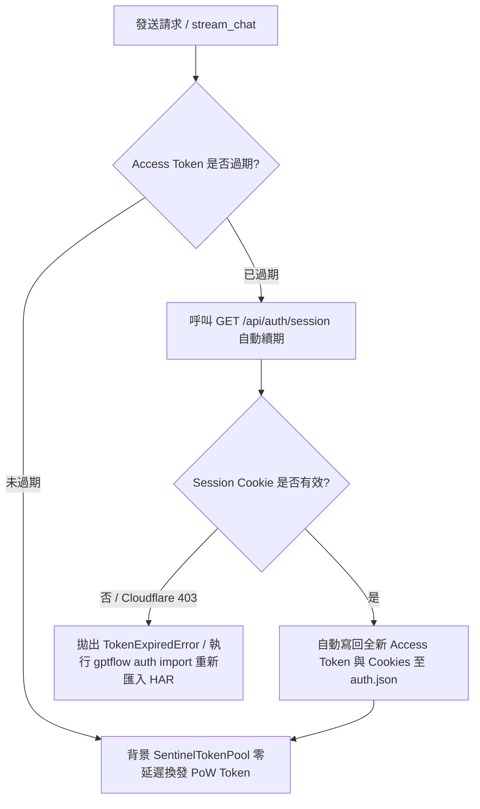

# GPTFlow

> 基於 Clean Architecture 與 DDD 設計的非同步 ChatGPT Web 逆向工程客戶端與 CLI 工具。

---

## 核心能力清單

- **TLS / JA3 指紋模擬**：內建 `curl_cffi` 模擬 Chrome 131 握手特徵，繞過 Cloudflare WAF 攔截。
- **Sentinel PoW 演算法**：字符級復刻 OpenAI 官方混淆 32 位元 FNV-1a / Murmur 雜湊演算法（`sentinel_hash`），背景 Token 池自動預算。
- **思考鏈 (Thinking / CoT) 原生支援**：帶入 `system_hints: ["reason"]`，終端即時分離並渲染 `思考思維鏈` 區塊。
- **增量修補流解析**：解析 `delta_encoding v1` JSON-patch SSE 事件串流。
- **多輪對話 DAG 管理**：維護本地訊息節點樹與 `parent_message_id` 指標。
- **Token 自動續期機制**：自動透過 NextAuth Session 端點滾動刷新 JWT 與 Cookie，免頻繁重新登入。

---

## 快速開始

### 1. 安裝環境
本專案基於 `uv` 管理環境與依賴：
```bash
# 同步安裝依賴
uv sync
```

### 2. 匯入身分認證 (HAR 匯入)
在瀏覽器開啟 `https://chatgpt.com`，按 F12 開啟「開發者工具」->「網路 (Network)」，任發送一則訊息或重新整理頁面，對請求按右鍵「另存為包含內容的 HAR」，執行：
```bash
# 匯入 HAR 封包 (自動擷取 Authorization Bearer JWT、oai-did 及全部 24 個必要 Cookies)
uv run gptflow auth import "路徑/封包紀錄.json"

# 檢視當前認證狀態
uv run gptflow auth status
```

---

## 常用 CLI 指令速查

### 單次即時串流問答 (`gptflow chat`)
```bash
# 基本串流問答
uv run gptflow chat "請簡要說明什麼是量子糾纏？"

# 開啟思考思維鏈模式 (-t / --thinking)
uv run gptflow chat "請分析 13*14 的心算方式" -t

# 接續指定會話的多輪對話
uv run gptflow chat "那 17*18 呢？" --session-id <會話ID>
```

### 互動式多輪對話 (`gptflow repl`)
```bash
# 開啟終端互動式問答 (支援上下鍵歷史紀錄、多輪上下文記憶)
uv run gptflow repl

# 開啟思考鏈模式
uv run gptflow repl -t

# 載入歷史會話繼續交談
uv run gptflow repl --session-id <會話ID>
```

### 會話紀錄管理 (`gptflow session`)
```bash
# 列出本地所有儲存的會話
uv run gptflow session list

# 檢視指定會話的歷史問答
uv run gptflow session show <會話ID>
```

### 認證管理 (`gptflow auth`)
```bash
# 檢視當前憑證有效性、Email、訂閱方案與 Cookie 數量
uv run gptflow auth status

# 手動向伺服器刷新 Access Token 與 Cookie
uv run gptflow auth refresh

# 重新匯入 HAR 檔案
uv run gptflow auth import <檔案路徑>
```

---

## Token 與 Cookie 壽命及過期處置機制

### 1. 各種 Token 與 Cookie 的有效期限

| 憑證類型 | 來源與機制 | 預估效期 | 過期表現 |
| :--- | :--- | :--- | :--- |
| **Sentinel Token**<br>(`chat_requirements_token`) | PoW 計算與 `/sentinel/finalize` 換發 | **約 3 分鐘** | 請求拒絕 (403 Sentinel Failed) |
| **Access Token**<br>(`Authorization: Bearer <JWT>`) | `https://auth.openai.com` 簽發的 JWT | **約 10 ~ 14 天**<br>(見 payload `exp`) | 請求報 401 Unauthorized |
| **Session Cookie**<br>(`__Secure-next-auth.session-token`) | NextAuth 登入憑證 (分卷存於 `.0` 與 `.1`) | **約 30 ~ 90 天**<br>(滾動式延長) | 無法刷新 Access Token |
| **Cloudflare Cookies**<br>(`cf_clearance`, `__cf_bm`) | Cloudflare 邊緣節點防護與機器人驗證 | **30 分鐘 ~ 數天**<br>(受 IP 變更影響) | 請求報 403 CloudflareBlockedError |
| **裝置識別碼**<br>(`oai-did`) | OpenAI 裝置綁定 UUID | **1 年** | 無實質影響 |

---

### 2. 過期時的處置流程



1. **Access Token 過期（無感自動處理）**：
   - 當程式檢測到 Access Token 到期時，**`ChatService` 會自動攔截並帶上現有 Cookie 呼叫 `GET /api/auth/session`**。
   - 伺服器會返回新的 `accessToken` 與更新後的滾動 Cookies，系統自動持久化回 `user_cookies/auth.json`，對話流程完全無中斷。
   - 亦可隨時手動執行 `uv run gptflow auth refresh` 進行續期。

2. **Sentinel Token 過期（無感自動處理）**：
   - 由 `SentinelTokenPool` 在背景常駐預運算，需要送出對話時直接取出已求解之新鮮 Token（效期內），耗盡時自動非同步補充。

3. **Cookie 過期 / 網路 IP 變更（需重新匯入）**：
   - **成因**：當外網 IP 變更（如切換 WiFi / VPN）導致 Cloudflare `cf_clearance` 失效，或超過 30~90 天 Session 自然失效、或手動在網頁點擊了「登出」。
   - **處置方式**：
     - 打開瀏覽器訪問 `https://chatgpt.com` 重新登入或按 F5。
     - DevTools 匯出最新 HAR 檔案。
     - 終端執行：`uv run gptflow auth import <new.har>` 即可立即恢復。

---

## 測試與驗證

```bash
# 執行所有單元測試 (PoW 演算法、SSE 增量解析、DAG 會話、負載建構器)
uv run pytest

# 執行靜態代碼檢查
uv run ruff check .

# 自動格式化代碼
uv run ruff format .
```
