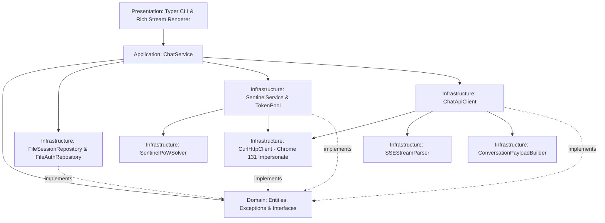

# GPTFlow: 現代化 ChatGPT Web 非同步高架構客戶端與 CLI 工具

> **高品質設計保證**：完全採用 **Clean Architecture（整潔架構）** 與 **領域驅動設計（DDD）**，拒絕修補式設計與過度妥協，原生基於 Python 3.12+ 與 `uv` 套件管理器打造。

---

## 🌟 核心特色

1. **Clean / Hexagonal 架構 (嚴格依賴反轉 DIP)**
   - **Domain (領域層)**：純 Python 與 Pydantic v2 定義的實體、值物件、列舉與抽象介面，完全無外部框架或 HTTP 庫污染。
   - **Application (應用層)**：協調業務邏輯（會話樹狀態轉移、身分驗證生命週期、Sentinel 權杖排隊與調度）。
   - **Infrastructure (基礎設施層)**：底層實現（基於 `curl_cffi` 的 JA3 指紋 impersonation、Sentinel PoW 演算法、HAR 封包解析、本地 JSON/DAG 儲存）。
   - **Presentation (展示層)**：使用 Typer 與 Rich 提供現代化、美觀且具備色彩樣式的命令列體驗。

2. **完整逆向 OpenAI Sentinel 安全攻防體系**
   - 逆向分析 `https://chatgpt.com/sentinel/20260810913b/sdk.js`。
   - 實現客製化 32-bit FNV-1a / Murmur 混合雜湊演算法（`sentinel_hash`），字符級相容官方 JavaScript 實作。
   - 支援 `/sentinel/chat-requirements/prepare`、PoW 挑戰求解、`/finalize` 驗證與心跳 `/ping`。
   - 內建 `SentinelTokenPool` 背景預運算機制，零延遲獲取新鮮的安全憑證。

3. **完整支援 ChatGPT Web 最新通訊協議**
   - **投機預熱 (Speculative Conduit Token)**：完整模擬 `/backend-api/f/conversation/prepare`，取得並攜帶 `x-conduit-token`。
   - **Delta 增量串流解析 (`delta_encoding v1`)**：精準解析 JSON-Patch SSE 事件流，自動拼接文字區塊。
   - **Thinking / 思考鏈原生支援**：支援最新推理模型（傳遞 `system_hints: ["reason"]`），終端即時渲染專屬 `🧠 思考思維鏈` 區塊，思考結束後自動展開主要回答。
   - **WAF 穿透**：藉由 `curl_cffi` 模擬 Chrome 131 TLS 握手與 HTTP/2 幀特徵，完美通過 Cloudflare 防護。

4. **DAG 對話樹狀結構管理**
   - 本地儲存自動維護多輪對話的訊息節點樹（DAG），精確記錄每輪對話的 `parent_message_id`，確保多輪對話上下文不斷鏈。

---

## 🏗️ 系統架構圖 (Clean Architecture)



---

## 🚀 快速安裝與環境準備

本專案強烈建議使用現代 Python 套件管理器 [`uv`](https://github.com/astral-sh/uv)：

```bash
# 1. 複製專案並進入專案目錄
cd c:\Users\JasonHong\Desktop\CODE\_Project\GPTFlow

# 2. 自動同步環境與依賴
uv sync
```

---

## 🔑 認證設定 (一鍵 HAR 匯入)

你可以直接從瀏覽器開發者工具 (F12) 的「網路 (Network)」標籤頁匯出包含登入 ChatGPT Web 請求的 `.har` 檔案，一鍵無痛匯入認證資訊：

```bash
# 匯入 HAR 封包 (自動擷取 Authorization Bearer JWT、oai-did 及全部 23 個必要 Cookies)
uv run gptflow auth import "Packet/第二個 session 封包紀錄.json"

# 檢視當前認證與訂閱狀態
uv run gptflow auth status
```

---

## 💻 CLI 指令說明

### 1. 單次問答 (`gptflow chat`)

```bash
# 基本即時串流回答
uv run gptflow chat "請簡要說明什麼是量子糾纏？"

# 開啟思考鏈模式 (Thinking / Reason)
uv run gptflow chat "請分析 13*14 的心算方式" --thinking

# 接續既有會話進行多輪對話
uv run gptflow chat "那 17*18 呢？" --session-id <會話ID>
```

### 2. 互動式終端多輪對話 (`gptflow repl`)

```bash
# 啟動新對話
uv run gptflow repl

# 啟動思考模式對話
uv run gptflow repl -t

# 載入歷史會話繼續交談
uv run gptflow repl --session-id <會話ID>
```

### 3. 會話紀錄管理 (`gptflow session`)

```bash
# 列出本機所有儲存的會話
uv run gptflow session list

# 查看指定會話的完整問答歷史
uv run gptflow session show <會話ID>
```

---

## 📂 專案目錄結構

```text
GPTFlow/
├── gpt_flow/
│   ├── application/               # 應用服務層
│   │   └── chat_service.py        # 核心問答與對話會話調度服務
│   ├── domain/                    # 領域層 (純粹領域模型與介面)
│   │   ├── entities.py            # MessageNode, ConversationTree, AuthCredentials...
│   │   ├── enums.py               # AuthorRole, StreamEventType, ModelKind...
│   │   ├── exceptions.py          # 領域專屬異常架構
│   │   └── interfaces.py          # DIP 依賴反轉介面 (IHttpClient, IChatClient...)
│   ├── infrastructure/            # 基礎設施層 (具體協議與實作)
│   │   ├── auth/                  # JWT 解析與憑證校驗
│   │   ├── clients/               # CurlHttpClient (TLS 指紋), ChatApiClient, SSEParser
│   │   ├── sentinel/              # SentinelPoWSolver, SentinelService, TokenPool
│   │   └── storage/               # FileAuthRepository, FileSessionRepository
│   ├── presentation/              # 展示層 (CLI 與渲染器)
│   │   ├── cli/                   # Typer CLI 命令定義
│   │   └── renderers/             # Rich 即時串流與思考區塊渲染器
│   └── config.py                  # Pydantic 應用配置
├── tests/                         # 單元與整合測試套件
│   ├── test_conversation_builder.py
│   ├── test_dag_session.py
│   ├── test_pow_solver.py
│   └── test_sse_parser.py
├── pyproject.toml                 # 現代化專案標準配置 (Hatchling + uv)
└── README.md
```

---

## 🧪 測試與代碼品質規範

專案所有代碼均符合 Python 3.12 型別提示標準，並通過 Ruff 與 Pytest 驗證：

```bash
# 執行所有單元測試 (PoW 求解器、SSE 增量解析、DAG 會話、負載建構器)
uv run pytest

# 執行 Ruff 代碼靜態檢查
uv run ruff check .

# 代碼自動格式化
uv run ruff format .
```
